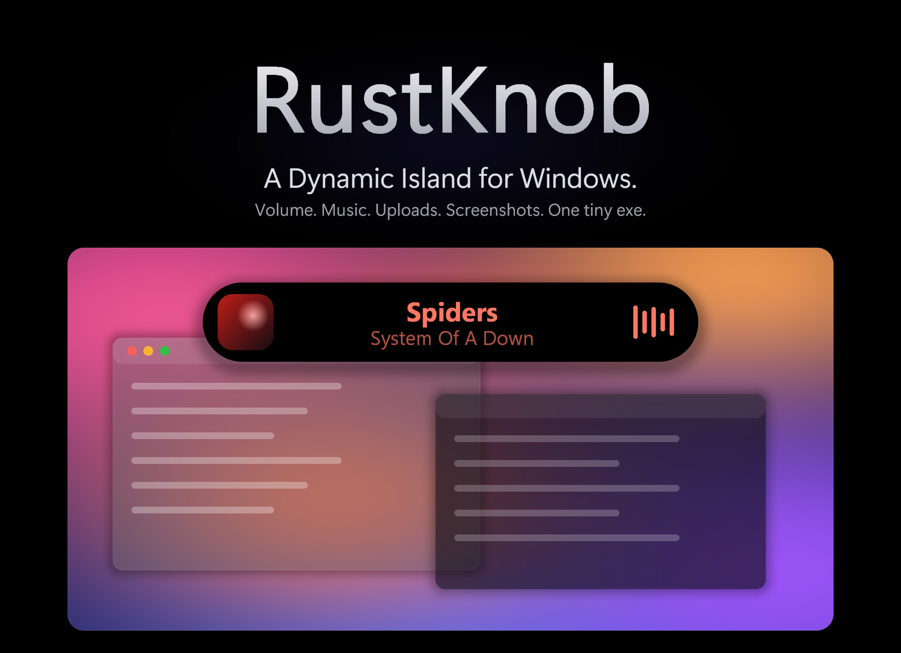
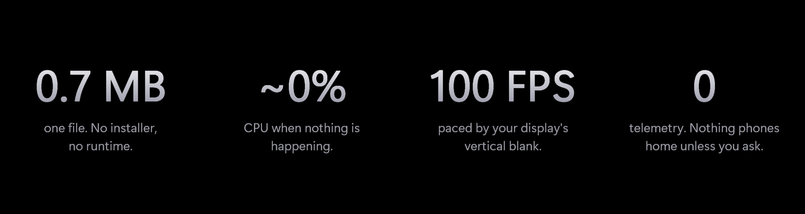
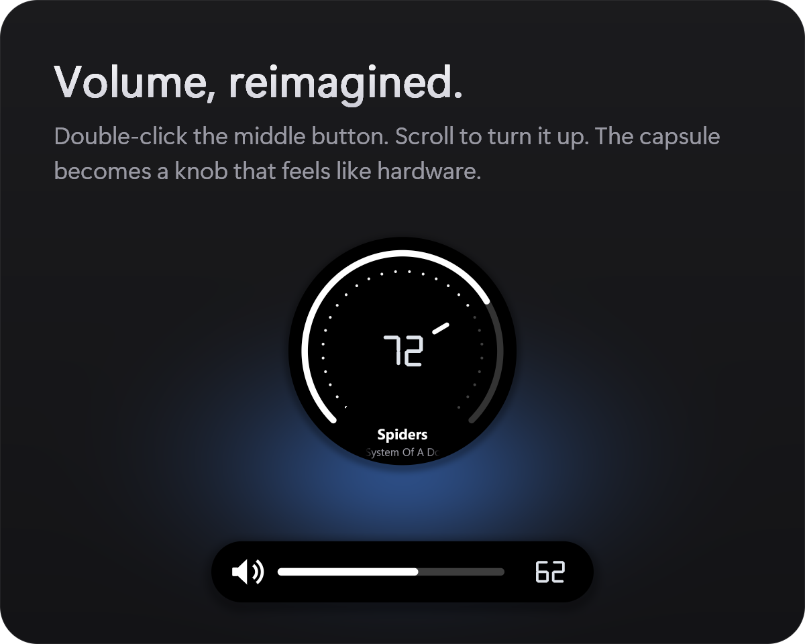
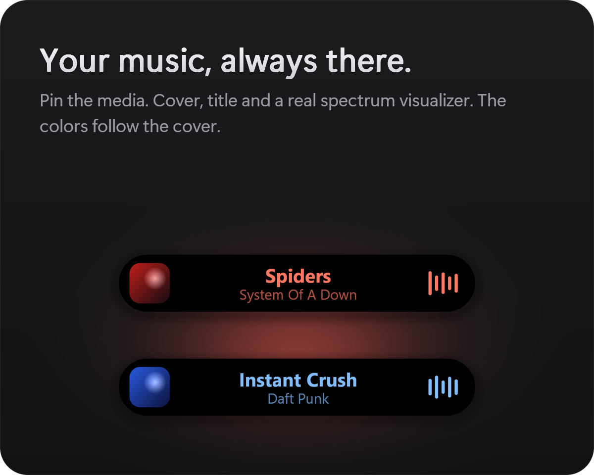
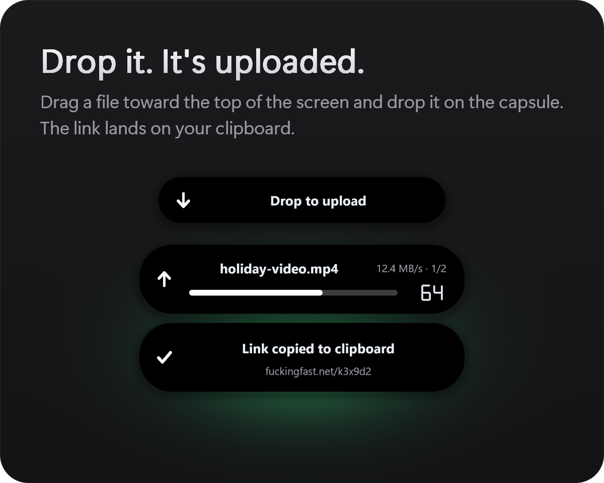
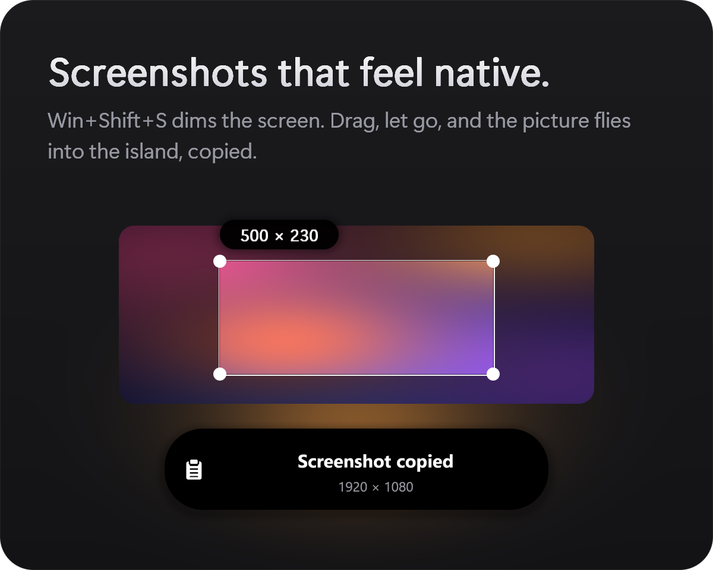
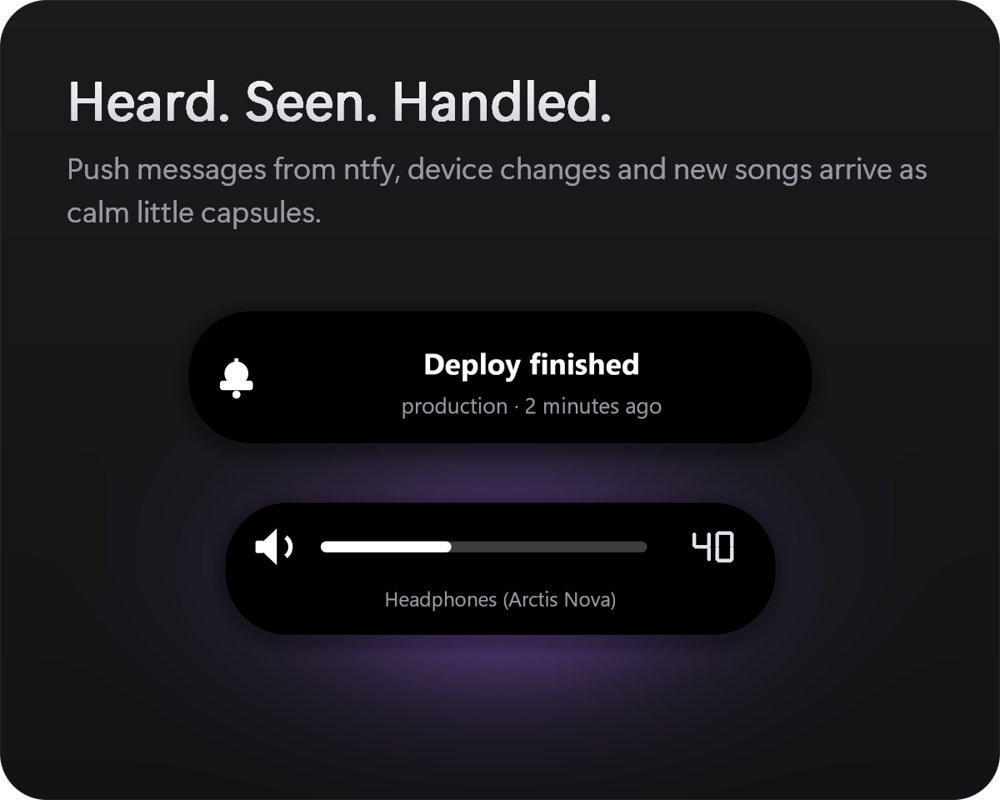
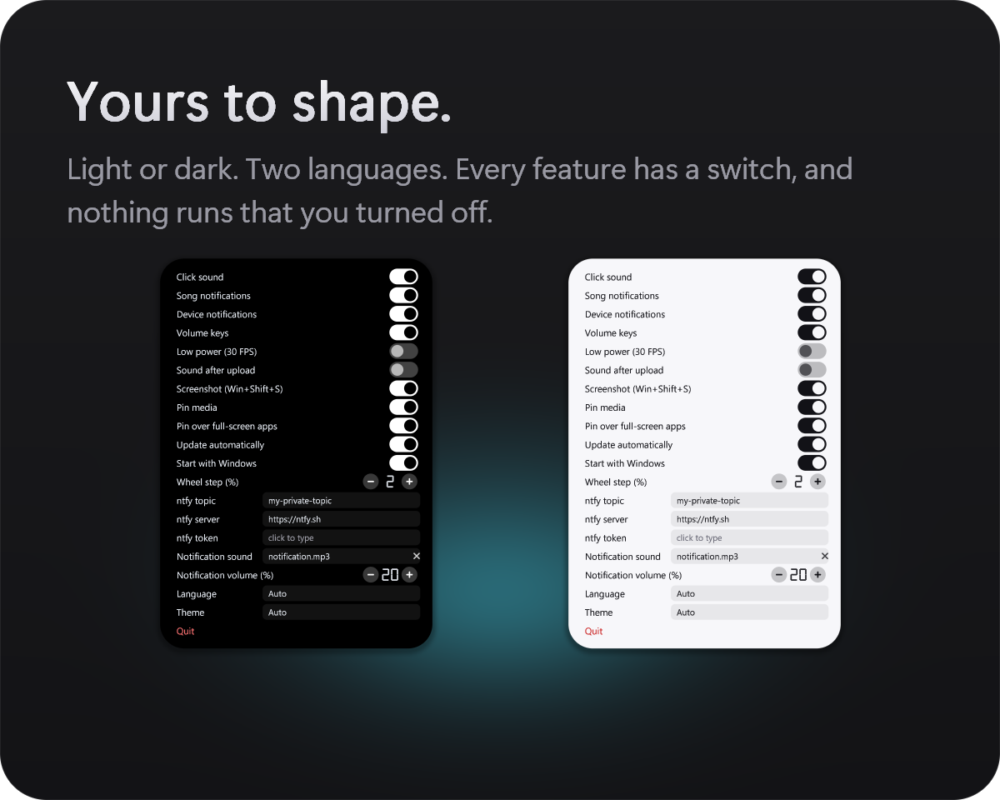
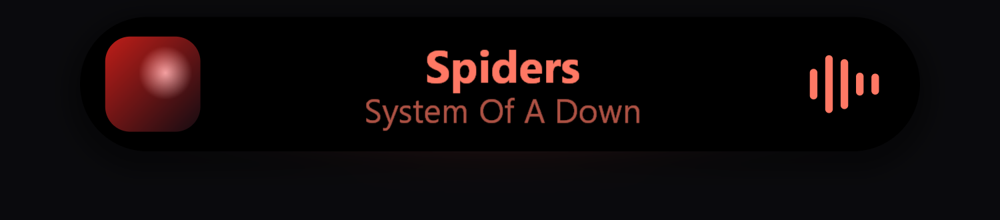
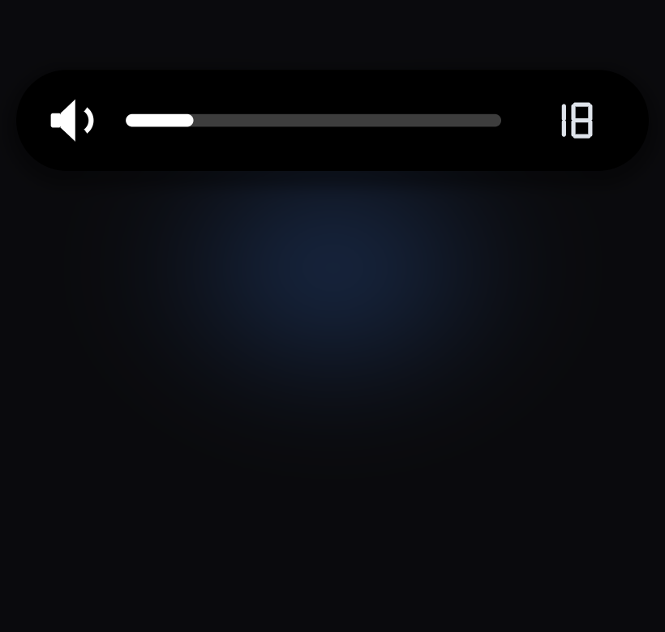

<div align="center">



<br>

<a href="https://github.com/thatsdai00/RustKnob/releases/latest"></a>

<sub>Windows 10 and 11 · one 0.7 MB file · no installer, no admin rights</sub>

</div>

<br>



<br>

## Everything, in one capsule

<table>
<tr>
<td width="50%"></td>
<td width="50%"></td>
</tr>
<tr>
<td width="50%"></td>
<td width="50%"></td>
</tr>
<tr>
<td width="50%"></td>
<td width="50%"></td>
</tr>
</table>

<br>

## In motion

<p align="center">
  
</p>
<p align="center">
  
</p>

<br>

## Get it

1. **Download** `RustKnob.exe` from the [latest release](https://github.com/thatsdai00/RustKnob/releases/latest).
2. **Double-click it.** A small setup capsule drops from the top of the screen. Pick *Start with Windows*, *Update automatically*, a language and a theme, then press **Install**.
3. **Done.** It installs for your user only and starts. The icon sits next to the clock (Windows 11 may hide it behind `^`: drag it out).

SmartScreen may say "unknown publisher" because the exe is not code-signed: *More info → Run anyway*. *Just run* starts it from where it is, without installing.

### Always current

RustKnob checks this repository's [releases](https://github.com/thatsdai00/RustKnob/releases) now and then. A newer `RustKnob.exe` is downloaded, **checked against the SHA-256 GitHub publishes for that file**, installed over the old one when nothing is going on, and started again. Your settings stay. Turn it off any time under *Update automatically*. Double-clicking a newer exe over an older install offers **Update** too.

<br>

## What you can do

| | |
|---|---|
| **Volume** | Double-click the middle mouse button (or `Ctrl+Alt+K`). Scroll: the capsule turns into a round **knob**, and the page behind does not scroll. Volume keys use it instead of Windows' popup. |
| **Media** | Song changes show title and artist. Mouse back/forward, left click and right click over the capsule control playback; the side buttons work in a wider area around it. |
| **Pin media** | The capsule stays while music plays, like a Live Activity: cover, title, artist, and a **real spectrum visualizer** that takes the cover's color. Song changes animate. It fades when the pointer comes near, and steps aside for full-screen apps unless you say otherwise. |
| **Uploads** | Drag a file toward the top of the screen and drop it on the capsule. It uploads to fuckingfast.net with progress and speed, and the link is copied. `Ctrl+Alt+H` opens the history. |
| **Screenshots** | `Win+Shift+S` freezes and dims the screen. Drag a rectangle: it is copied, shrinks into the island, and `Ctrl+V` later tells you where it was pasted. `Esc` or right click cancels. |
| **Notifications** | Listens to a [ntfy](https://ntfy.sh) topic and shows messages with their own sound and volume. Device changes show the device name. |
| **Settings** | `Ctrl+Alt+Shift+K` or the tray icon. English / Türkçe, dark / light / auto, a 30 FPS low-power mode, and a switch for every feature. |

### Shortcuts

| Keys / action | Result |
|---|---|
| Double middle click · `Ctrl+Alt+K` | Volume capsule (the hotkey closes it again) |
| Wheel with the capsule open | Volume; the capsule becomes the knob |
| Left / right click on it | Play-pause / next |
| Mouse back / forward near it | Previous / next song |
| `Ctrl+Alt+H` | Link history |
| `Ctrl+Alt+Shift+K` | Settings |
| `Win+Shift+S` | Screenshot (or run `RustKnob.exe --snip` from any shortcut) |

<br>

## Light on purpose

- **Idle is idle.** A few MB of memory, no timers, no polling. It only listens to the mouse and keyboard hooks.
- **Smooth.** Animations follow your display's vertical blank (up to 100 FPS), and only the part of the capsule that changed is redrawn.
- **Pay for what you use.** Cover decoding and audio capture exist only while *Pin media* is on and music is playing.
- **Polite.** Low priority, efficiency mode when nothing is on screen, no focus stealing. It never competes with a game.

## Privacy

RustKnob talks to the network only for what you ask: uploads (fuckingfast.net), the ntfy topic you set, and the update check (GitHub). Settings live in `rustknob.ini` (next to the exe, or in `%APPDATA%\RustKnob`), the link history in `%LOCALAPPDATA%\RustKnob`. Nothing else leaves your PC.

## Build

```
cargo build --release
```

Needs Rust and the Visual Studio C++ build tools. `package.ps1` writes `dist/RustKnob.exe` and a zip. The pictures above are drawn by the real renderer: `cargo run --release --features demo -- --demo docs/img`.

## Uninstall

*Apps & features* → RustKnob, or tray icon → *Uninstall*. Your settings file is kept.

---

# Türkçe

**RustKnob**, Windows için Dynamic Island tarzı bir kapsül: ses çubuğu, yuvarlak ses düğmesi, çalan şarkı, yükleme, ekran görüntüsü, bildirim ve ayarlar arasında şekil değiştirir. Odak çalmaz, borderless oyunların üstünde çalışır, boştayken neredeyse hiç CPU kullanmaz. Tek bir ~0,7 MB Rust exe.

**Kurulum:** [Son sürümden](https://github.com/thatsdai00/RustKnob/releases/latest) `RustKnob.exe` indir, çift tıkla, kurulum kapsülünde seçimlerini yapıp **Kur**'a bas. Yönetici izni gerekmez. SmartScreen uyarırsa *Ek bilgi → Yine de çalıştır* (exe imzalı değil).

**Güncelleme:** Yeni sürüm çıkınca indirilir, GitHub'ın yazdığı SHA-256 ile doğrulanır, ekranda bir şey yokken kurulur. Ayarların korunur; ayarlardan kapatılabilir.

| | |
|---|---|
| **Ses** | Orta tuşa çift tık (veya `Ctrl+Alt+K`), tekerlekle yuvarlak düğmeye dönüşür. |
| **Medya** | Yeni şarkıda başlık ve sanatçı; fare tuşlarıyla şarkı yönetimi. |
| **Medyayı sabitle** | Kapak, şarkı, sanatçı ve gerçek spektrum görselleştirici; renkler kapaktan gelir. |
| **Yükleme** | Dosyayı sürükleyip kapsüle bırak: fuckingfast.net'e yüklenir, link kopyalanır (`Ctrl+Alt+H` geçmiş). |
| **Ekran görüntüsü** | `Win+Shift+S`: seç, panoya kopyalansın, kapsüle uçsun; `Ctrl+V`'de nereye yapıştırıldığını söyler. |
| **Bildirimler** | [ntfy](https://ntfy.sh) konusunu dinler. |
| **Ayarlar** | `Ctrl+Alt+Shift+K` ya da tepsi simgesi. |

Derleme: `cargo build --release`.
