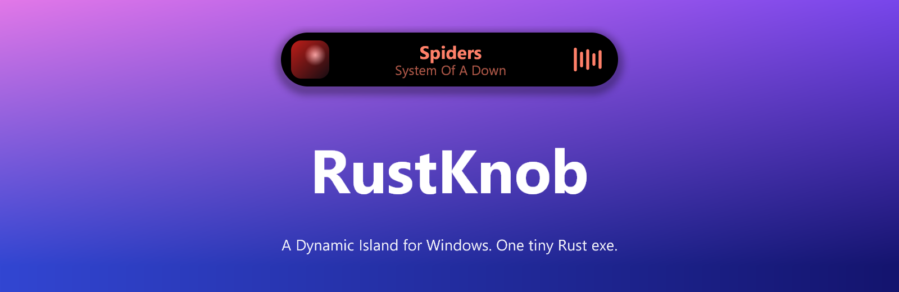
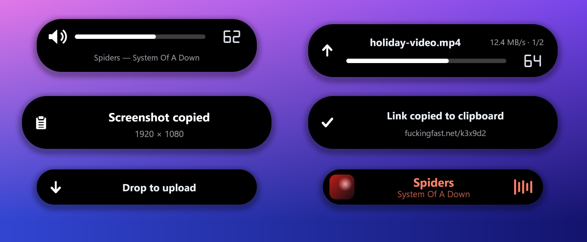
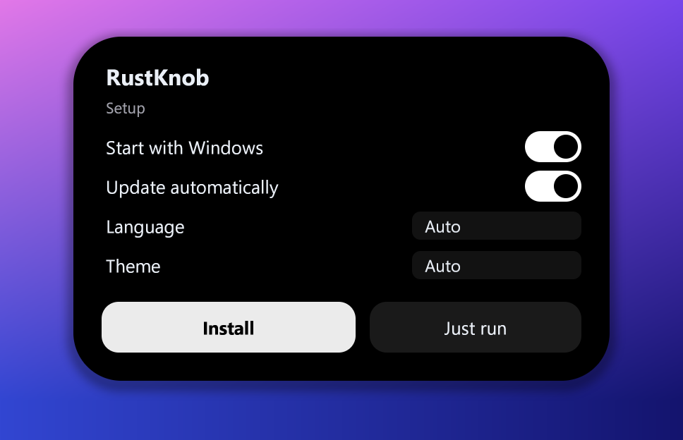
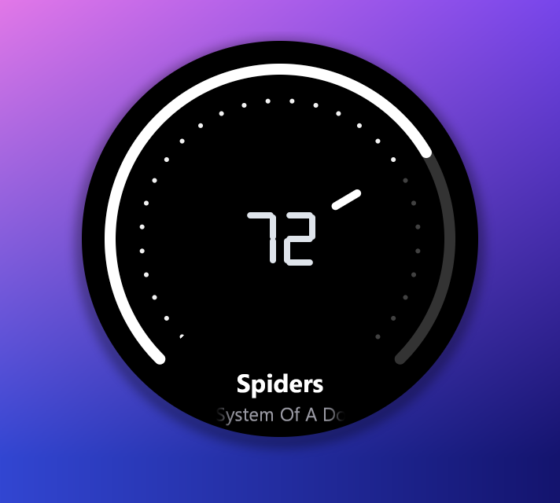
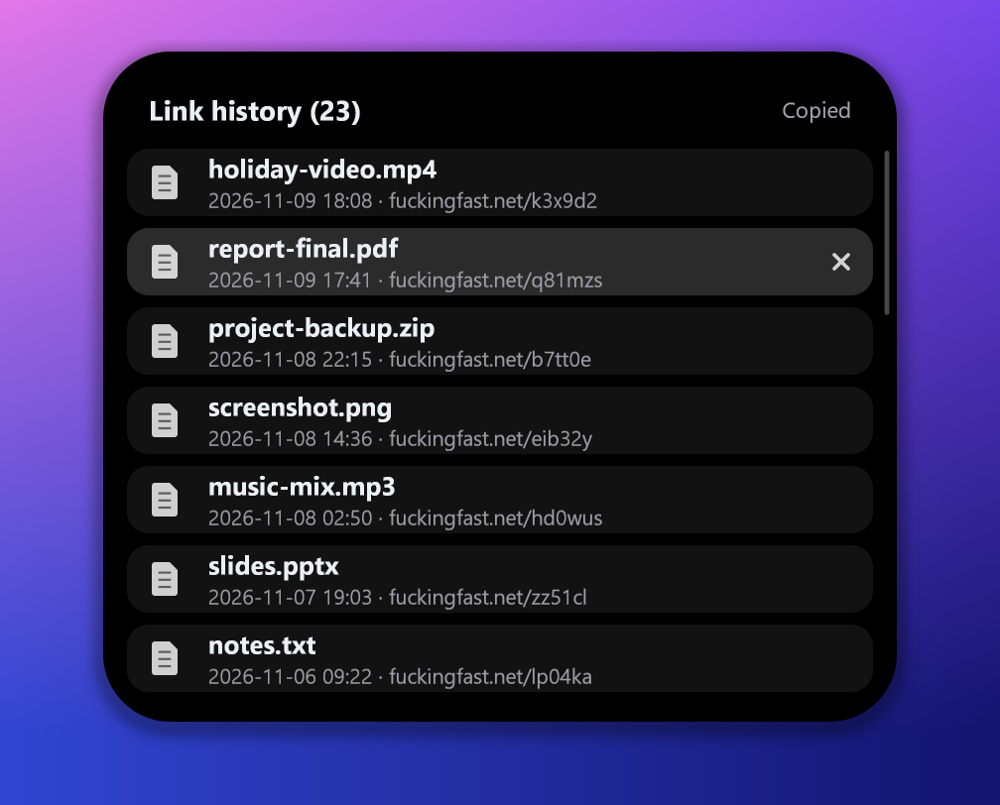
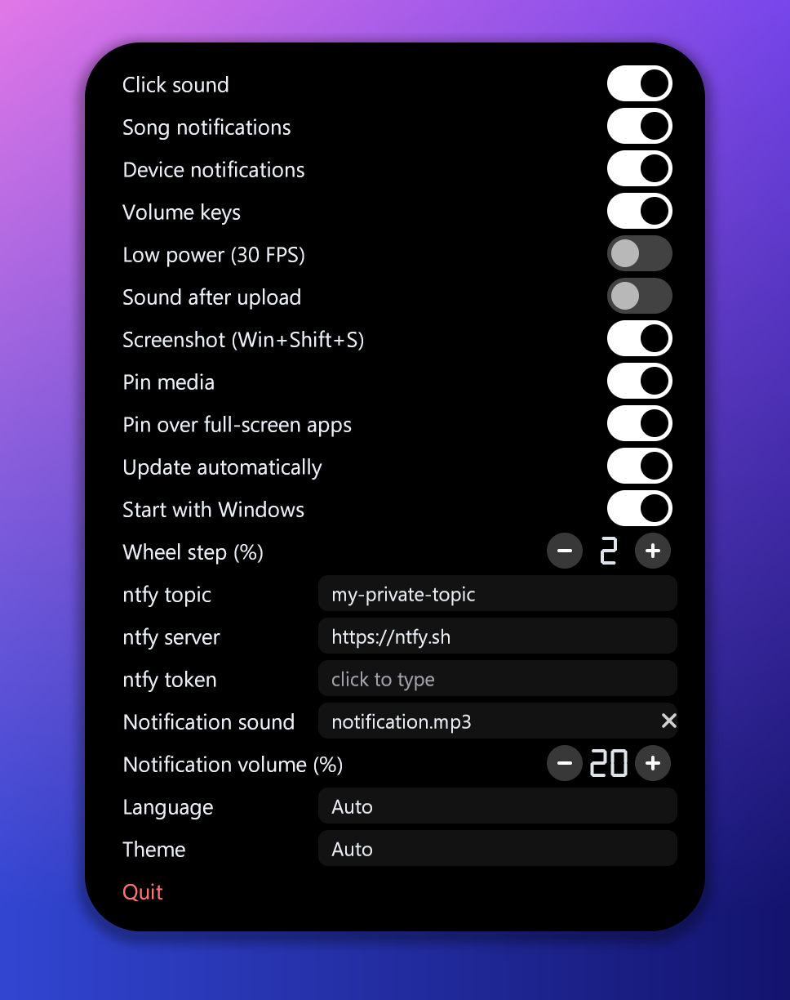

<p align="center">
  
</p>

<p align="center">
  <a href="https://github.com/thatsdai00/RustKnob/releases/latest"></a>
  
  
  
</p>

**RustKnob** is a Dynamic-Island-style capsule for Windows. It sits at the top of your screen, morphs between a volume bar, a round volume knob, now-playing, upload progress, notifications and settings, and stays out of your way: it never takes focus, it works over borderless games, and when nothing happens it uses next to no CPU or memory.

Everything is in a single ~0.7 MB exe written in Rust. No runtime, no installer, no Electron.

<p align="center">
  
</p>

---

## Install

1. Download **`RustKnob.exe`** from the [latest release](https://github.com/thatsdai00/RustKnob/releases/latest).
2. Double-click it. A small setup capsule drops from the top of the screen: choose *Start with Windows*, *Update automatically*, language and theme, then press **Install**.
3. That is all. It installs for your user only (no administrator rights) and starts. Look for the icon near the clock (Windows 11 may keep it behind the `^` arrow: drag it out).

Windows SmartScreen may say "unknown publisher", because the exe is not code-signed: *More info → Run anyway*.

*Just run* starts it from where it is, without installing.

<p align="center">
  
</p>

### Updates

RustKnob checks the [releases](https://github.com/thatsdai00/RustKnob/releases) of this repository now and then. When there is a newer one it downloads `RustKnob.exe`, **verifies it against the SHA-256 GitHub lists for that file**, installs it over the old one when nothing is going on, and starts again. Your settings stay. Switch it off in the settings ("Update automatically") or in the setup.

An older copy that is already installed is also updated when you double-click a newer `RustKnob.exe`: the setup capsule offers **Update**.

---

## What it does

| | |
|---|---|
| **Volume** | Double-click the middle mouse button (or `Ctrl+Alt+K`): a volume capsule drops. Scroll while it is open and it morphs into a round **knob** (the wheel does not scroll the page meanwhile). Volume keys use it too, instead of Windows' own popup. |
| **Media** | New song → artist and title. Mouse back/forward buttons, left click and right click over the capsule control playback. Mouse side buttons work in a wider area around it, so it is easy to hit. |
| **Pin media** | Optional. The capsule stays up while music plays, like the Live Activity on an iPhone: cover on the left, title and artist in the middle, a **real spectrum visualizer** on the right. The text takes the color of the cover. Changing songs animates. Fades away when the pointer comes near it; steps aside for full-screen apps unless you say otherwise. |
| **Uploads** | Drag a file from Explorer or the desktop: a drop capsule appears at the top. Drop the file on it and it uploads to fuckingfast.net with a progress bar and speed; the link is copied. `Ctrl+Alt+H` shows the link history (click copies, `x` removes). |
| **Screenshots** | `Win+Shift+S` freezes and dims the screen; drag a rectangle and let go: it is copied to the clipboard. The captured part shrinks into the capsule. Press `Ctrl+V` and the capsule tells you where it was pasted. `Esc` or right click cancels. |
| **Push notifications** | Listens to a [ntfy](https://ntfy.sh) topic and shows the messages in the capsule (own sound, own volume). |
| **Device changes** | Switching the default sound device shows its name. |
| **Settings** | `Ctrl+Alt+Shift+K` or the tray icon. Language (English / Türkçe), theme (dark / light / auto), low-power 30 FPS mode and more. |

<p align="center">
  
  &nbsp;
  
  &nbsp;
  
</p>

### Shortcuts

| Keys / action | Result |
|---|---|
| Double middle click · `Ctrl+Alt+K` | Volume capsule (the hotkey closes it again) |
| Wheel (capsule open) | Volume; the capsule becomes the knob |
| Left click / right click over it | Play-pause / next |
| Mouse back / forward buttons near it | Previous / next song |
| `Ctrl+Alt+H` | Link history |
| `Ctrl+Alt+Shift+K` | Settings |
| `Win+Shift+S` | Screenshot (or `RustKnob.exe --snip` from any other shortcut) |

---

## Light on purpose

- Idle: a few MB of memory, no timers, no polling. It only listens to the mouse and keyboard hooks.
- Animations are paced by the display's vertical blank, so frames land evenly (up to 100 FPS); only the part of the capsule that changed is redrawn.
- Media features cost nothing while they are off: the pinned capsule's cover decoding and audio capture exist only while *Pin media* is on and music is playing.
- It runs at low priority and in efficiency mode when nothing is on screen, so it never competes with a game.

## Build

```
cargo build --release
```

Needs the Rust toolchain and the Visual Studio C++ build tools. `package.ps1` builds and writes `dist/RustKnob.exe` and a zip. The pictures in this README are drawn by the real renderer: `cargo run --release --features demo -- --demo docs/img`.

## Privacy

RustKnob talks to the network only for what you ask: uploads (fuckingfast.net), the ntfy topic you set, and the update check (GitHub). Settings live in `rustknob.ini` (next to the exe, or in `%APPDATA%\RustKnob`); the link history in `%LOCALAPPDATA%\RustKnob`. Nothing is sent anywhere else.

## Uninstall

Windows *Apps & features* → RustKnob, or the tray icon → *Uninstall*. Your settings file in `%APPDATA%` is kept.

---

# Türkçe

**RustKnob**, Windows için Dynamic Island tarzı bir kapsül. Ekranın üstünde durur; ses çubuğu, yuvarlak ses düğmesi, çalan şarkı, yükleme, bildirim ve ayarlar arasında şekil değiştirir. Odak çalmaz, borderless oyunların üstünde çalışır, boştayken neredeyse hiç CPU ya da bellek kullanmaz. Tek bir ~0,7 MB Rust exe: ek kurulum, Electron yok.

### Kurulum
1. [Son sürümden](https://github.com/thatsdai00/RustKnob/releases/latest) **`RustKnob.exe`** dosyasını indir.
2. Çift tıkla. Ekranın üstünden küçük bir kurulum kapsülü iner: *Windows ile başlat*, *Otomatik güncelle*, dil ve temayı seç, **Kur**'a bas.
3. Bu kadar. Yönetici izni gerekmez, sadece senin kullanıcın için kurulur. Simgesi saatin yanında (Windows 11'de `^` okunun arkasında olabilir, dışarı sürükle).

Exe imzalı olmadığı için SmartScreen "bilinmeyen yayıncı" diyebilir: *Ek bilgi → Yine de çalıştır*.

### Güncelleme
RustKnob arada bir bu deponun [sürümlerine](https://github.com/thatsdai00/RustKnob/releases) bakar. Yeni sürüm varsa `RustKnob.exe`'yi indirir, **GitHub'ın o dosya için yazdığı SHA-256 ile doğrular**, ekranda bir şey yokken eskisinin üstüne kurar ve yeniden başlar. Ayarların korunur. Kapatmak için ayarlardaki ya da kurulumdaki "Otomatik güncelle" anahtarını kullan. Eski sürüm kuruluysa yeni `RustKnob.exe`'ye çift tıklamak da **Güncelle** teklif eder.

### Neler yapar
| | |
|---|---|
| **Ses** | Orta tuşa çift tık (veya `Ctrl+Alt+K`): ses kapsülü iner. Açıkken tekerleği çevirince yuvarlak **düğmeye** dönüşür. Ses tuşları Windows'un kendi balonu yerine bunu kullanır. |
| **Medya** | Yeni şarkıda sanatçı ve şarkı adı. Üstündeyken fare geri/ileri tuşları, sol ve sağ tık şarkıyı yönetir; yan tuşlar kapsülün çevresindeki geniş alanda da çalışır. |
| **Medyayı sabitle** | İsteğe bağlı. Müzik çalarken kapsül ekranda kalır (iPhone'daki Live Activity gibi): solda kapak, ortada şarkı ve sanatçı, sağda **gerçek spektrum görselleştirici**. Yazı kapağın rengini alır, şarkı değişirken animasyon oynar. İmleç yaklaşınca soluklaşır. |
| **Yükleme** | Gezgin'den ya da masaüstünden bir dosya sürükle: üstte bırakma kapsülü çıkar. Dosyayı üstüne bırak, fuckingfast.net'e yüklenir (ilerleme, hız), link kopyalanır. `Ctrl+Alt+H` link geçmişi. |
| **Ekran görüntüsü** | `Win+Shift+S` ekranı dondurup karartır; dikdörtgen sürükle, bırakınca panoya kopyalanır, seçilen kısım kapsüle küçülerek uçar. `Ctrl+V` yapınca nereye yapıştırıldığını söyler. |
| **Bildirimler** | Bir [ntfy](https://ntfy.sh) konusunu dinler, mesajları kapsülde gösterir. |
| **Ayarlar** | `Ctrl+Alt+Shift+K` ya da tepsi simgesi. Dil, tema, 30 FPS düşük güç modu ve daha fazlası. |

### Derleme
```
cargo build --release
```
Rust ve Visual Studio C++ derleme araçları gerekir.
